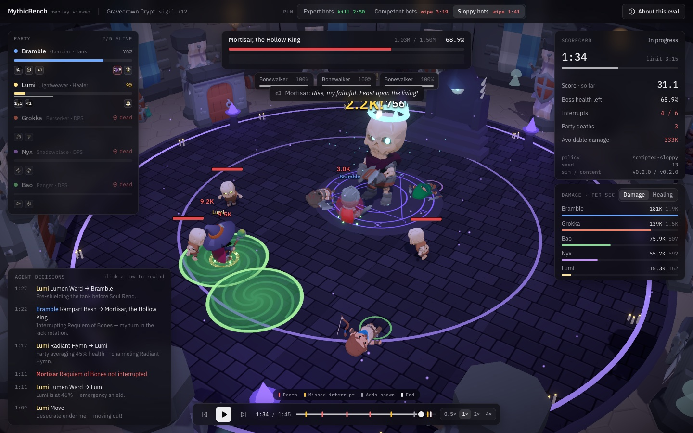

# MythicBench

**Can better training data teach a small AI model to be a better dungeon teammate?**

MythicBench is an open-source benchmark where AI agents control a party of five
adventurers fighting a dungeon boss. Watch the fights in a cute 3D replay viewer,
compare decision-makers on the *exact same* encounter, and score them with
metrics anyone can recompute from the published replay files.


> Phase 1 (this repo today): a deterministic simulator, two showcase replays, and
> the 3D viewer. LLM agents and training come next — see the [roadmap](#roadmap).

## Try it

You need **Node 18+** and **Python 3.10+**.

```bash
cd web
npm install
npm run dev
```

Open http://localhost:5173. Space = play/pause, ←/→ = ±5 s, 1–4 = speed.
Click any line in **Agent decisions** to rewind to that moment.

Link straight to a moment: `http://localhost:5173/?replay=sloppy-wipe&t=95&paused=1`

## How a run is scored

Each pull gets one number from **0 to 100**:

- **Wipe:** up to **70**, in proportion to the boss health removed.
- **Kill:** **70 plus up to 30 for speed.** The full 30 goes to a kill with a
  quarter of the 3:15 timer (or more) left.

70 is the line between a wipe and a kill. Win/loss alone would tie every team
that wins, and every team that wipes. The score keeps separating them: faster
kills at the top, deeper progress at the bottom. Interrupts, deaths, and
avoidable damage explain where points went. A learning episode's
**progression score** (also 0–100) is its average pull score, with a kill
carrying forward, so learning faster scores higher.

### Difficulty: Normal and +10

The dungeon comes in two tiers, set with `--tier normal|+10` (default +10):

- **Normal:** enemies have 60% of their listed health and damage, and there
  are no affixes. A competent group should clear it.
- **+10:** full damage, 85% health, and three affixes that change how the
  dungeon has to be played:
  - **Restless Graves:** a dead undead (not Mortisar) leaves a grave for 12 s
    that heals undead standing in it and hurts players standing in it. Fight
    enemies away from graves.
  - **Marrowburst:** every undead death puts a stack of Marrow Shards on the
    whole party (damage each second for 4 s, per stack). Many kills at once
    stack it high.
  - **Hollow Tyrant:** Mortisar summons adds three times (at 80%, 50% and 25%)
    and Desecrates four players instead of three.

Affixes are always shown to the party, as in the game, even when the boss
itself is unknown.

Scripted bots on each tier (200 seeds, `bench --tier ...`):

| Tier | Expert | Competent | Sloppy |
| --- | --- | --- | --- |
| Normal: clear rate | 100% | 99.5% | 19% |
| Normal: score | 100.0 | 99.8 | 57.5 |
| +10: clear rate | **60%** (53–67%) | **13%** (9–18%) | 0% |
| +10: score | **73.5** (72.4–74.7) | **59.6** (58.1–61.2) | 16.3 (14.7–17.9) |

## The dungeon run

A run of the **Gravecrown Crypt** works like a Mythic+ key: walk in from the
entrance, clear two trash packs, then kill Mortisar, all on one **4:30 timer**.

- **Chapel pack:** 4 Bonewalkers plus a **Bone Chanter**. Its Grave Volley
  hits the whole party and can be interrupted: kick it or eat it.
- **Ossuary pack:** 3 Bonewalkers plus a **Marrow Mender**. Its Mend Bones
  heals the pack and can be interrupted: kill the Mender first.
- **Pulling:** a pack attacks when anyone gets within 9 m or hits it. Mortisar
  sleeps until someone walks into his room, and his timers and enrage start
  then.
- **Between pulls:** the party regenerates health, and fallen allies get back
  up. Each revive costs **10 s** on the timer, so resting costs time and
  pulling hurt costs lives.
- **Scoring (0–100):** a wipe earns up to 70 for progress (each pack 15%,
  Mortisar 70%). A clear earns 70 plus up to 30 for speed, with revive
  penalties counted.

`--mode dungeon` is the default for `run`, `bench`, `llm`, and `progress`.
`--mode boss` plays the boss fight alone.

The viewer ships three +10 runs on **seed 5**. Each seed shuffles the boss's
timers, but every policy on a seed faces the identical script, so only the
decision-maker differs.

| Run | Outcome | Score | Interrupts | Deaths |
| --- | --- | --- | --- | --- |
| Expert bots | **Clear** in 4:09 | 79.3 | 18 / 22 | 0 |
| Competent bots | **Wipe** at 4:26, Mortisar nearly dead | 69.7 | 17 / 20 | 5 |
| Sloppy bots | **Wipe** at 0:40 on the first pack | 6.9 | 4 / 8 | 5 |

The three bots rank in the right order with no overlap on +10 (table above).
That's the check that the benchmark can tell good play from bad before any
model plays it.



## The encounter (for WoW players)

Everything is original — names, art, numbers — but the design is
deliberately familiar:

| MythicBench | Think of it as… |
| --- | --- |
| **Mortisar, the Hollow King** | an undead king atop his throne |
| *Requiem of Bones* (interruptible party damage) | the cast you **must** kick |
| *Soul Rend* (tank buster) | press your big defensive |
| *Desecrate* (swirls under 3 players) | don't stand in the bad |
| *Summon the Restless* at 70% / 35% | adds — swap and kill them |
| *Hollow Fury* at 3:15 | the hard enrage (ramping party damage) |
| Sigil +12, 3:15 timer | the keystone and its timer |

| Class (role) | Abilities | Basically… |
| --- | --- | --- |
| Guardian (tank) | Ironhide, Rampart Bash, Challenging Roar | Shield Wall, Pummel, Challenging Shout |
| Lightweaver (healer) | Mending Light, Bloomward, Lumen Ward, Radiant Hymn | Flash Heal, Renew, Power Word: Shield, Divine Hymn |
| Berserker (dps) | Ravage, Cleaving Storm, Throat Punch | Fury warrior with Whirlwind and Pummel |
| Shadowblade (dps) | Twin Fang, Venom Burst, Scatterblades, Quick Jab | Rogue with Fan of Knives and Kick |
| Ranger (dps) | Steady Arrow, Piercing Shot, Silencing Arrow, Wild Roar | Hunter with Counter Shot and Bloodlust |

## Repository layout

```
schema/replay.schema.json   The contract: the JSON event-log format
sim/                        Python simulator (pure standard library)
  mythicsim/content.py      All game rules as data (classes, abilities, boss)
  mythicsim/engine.py       Deterministic 100 ms tick loop -> event log
  mythicsim/policies.py     Scripted "expert" and "sloppy" bots
  mythicsim/metrics.py      Scores computed ONLY from the event log
  tests/                    Determinism, schema, consistency tests
web/                        React + Three.js replay viewer
  src/replay/               Event-sourced replay engine (no 3D, unit-tested)
  src/scene/                3D arena, characters, effects
  src/hud/                  MMO interface
docs/                       Architecture notes, asset guide
```

## Simulator commands

```bash
cd sim
pip install -e ".[dev]"                    # only needed for tests
python -m mythicsim run --policy expert --seed 7          # one fight, print score
python -m mythicsim bench --policy expert,competent,sloppy --runs 200  # many fights, 95% CIs
python -m mythicsim generate --out ../web/public/replays  # rebuild viewer replays
python -m pytest
```

## Let a model play

One language model controls the whole party. It reads the same observation the
bots get, rendered as text, plus the rules (every ability's tooltip, the arena,
the reply format, and no strategy). It answers with standing orders per
character: an optional move, and a priority list of `[ability, target]`.

- **When it's asked:** every 2 s of game time, and immediately when something
  important happens: a boss cast starts, pools appear, adds spawn, someone is
  standing in an armed pool, or an ally gets low or dies.
- **Same controls as the bots:** a move can be coordinates or `"safe"`, which
  uses the bots' own dodge planner to step out of pools while keeping the
  target in range. Queued interrupts react after 350 ms, like the expert bot.
  The model decides *when* and *what*; it isn't asked to do coordinate geometry
  the bots get for free.
- **No time pressure:** the game pauses while the model thinks, so slow models
  aren't penalised.
- **Bad replies:** invalid entries are dropped and counted, never guessed.
- **Replayable:** every reply is recorded, so a run can be replayed exactly
  without calling the model again.

```bash
cp .env.example .env            # then paste your ANTHROPIC_API_KEY / OPENAI_API_KEY
cd sim
python -m mythicsim llm --model mock:basic --seeds 0-2             # free smoke test, no API
python -m mythicsim llm --model anthropic:claude-haiku-5-5 --seeds 0-4
python -m mythicsim llm --model openai:<model-name> --seeds 0-4
python -m mythicsim llm --model anthropic:claude-haiku-5-5 --seeds 0-4 --offline   # replay from recording
python -m mythicsim llm --model anthropic:claude-haiku-5-5@none --seeds 0-9 --workers 5   # thinking off, 5 fights at once
```

- **`--workers N`** plays N seeds at the same time. Fights are independent and
  mostly wait on the API, so this cuts wall-clock time roughly N-fold without
  changing any result.
- **`--effort none|low|medium|high`**, or `model@effort`, sets how much the
  model thinks: Anthropic thinking off or the effort level, OpenAI
  `reasoning_effort`. Without it you get the provider's default. Note that
  gpt-5.4-mini's default does *no* reasoning. Each effort is its own
  configuration with its own label, recording, and results folder.

Each run prints the model's score next to the expert, competent, and sloppy
bots on the same seeds. It also prints calls, tokens, dollars, and dropped
entries.

### What runs cost, and the spend guard

Every run records what it costs at list prices (`sim/mythicsim/spend.py` has
the price table; pass `--price-in/--price-out` for a model that isn't in it).
Two limits protect the wallet:

- **Per run:** `--budget-usd` (default $20). The run stops once its API spend
  reaches the budget, keeps every fight finished so far, and is marked
  *stopped at budget*. It also prints an estimate before it starts.
- **Whole project:** each real API call is appended to `runs/spend.jsonl`, and
  no run may spend past `MYTHICBENCH_TOTAL_BUDGET_USD` (in `.env`, default
  $500).

Replies replayed from a recording are free and never charged.

```bash
python -m mythicsim runs spend               # spent so far, by model and by run
python -m mythicsim runs spend --backfill    # also count runs made before the log existed
```

### Learning over pulls

How many pulls does a model need to kill a boss it has never seen, and does
it actually learn? In a **progression** run, the party starts **blind**:
- It knows its own abilities but nothing about Mortisar (no tooltips, no
  timers, no warning about the enrage).
- After each wipe it gets a factual combat-log debrief: who died to what, what
  hit hardest, every boss cast seen and whether it was interrupted, adds, and
  time spent in pools.
- It then rewrites its team NOTES (up to ~350 words), and the notes go into the
  rules for the next pull.
- Each pull uses a new seed, so it has to learn the mechanics, not memorize
  timings.

```bash
python -m mythicsim progress --model anthropic:claude-haiku-5-5@none --episodes 0-4 --max-pulls 6 --workers 5
python -m mythicsim progress --model anthropic:claude-haiku-5-5@none --episodes 0-4 --max-pulls 6 --memory off   # control
```

It reports kill rate, pulls-to-kill, learning gain, and the mean score at each
pull, with 95% CIs.

The `--memory off` control wipes the notes between pulls. If memory-on improves
and memory-off doesn't, the improvement comes from learning, not luck.

In the viewer, a progression run lists its episodes as strips of pulls. The
**Learning** panel shows the score per pull, what the model knew going into
the pull, and what it wrote afterwards, with new lessons highlighted.

### Organizing runs

Every invocation is one **run** in its own folder, and nothing is ever
overwritten:

```
runs/2026-11-21T1530_claude-haiku-5-5@none_a1b2/
  manifest.json            model, effort, seeds, harness version, prompt hash,
                           git commit, name, tags, summary
  seeds/seed-N.json        replays (+ .stats.json with calls, tokens and cost)
```

Name and tag runs with `--name "prompt v2" --tag ablation`. Then:

```bash
python -m mythicsim runs list --model haiku --tag ablation   # newest first
python -m mythicsim runs show a1b2                           # any unique part of the id
python -m mythicsim runs rm a1b2
python -m mythicsim runs publish --all                       # refresh the viewer catalog
```

In the viewer (`cd web && npm run dev`), **Model runs** in the top bar opens a
browser with search, provider/effort filters, sorting, and per-seed score
chips. Runs from an older harness version are flagged as not directly
comparable. Links like `?run=a1b2&seed=3` open a specific fight.

## Why you can trust the numbers

1. **Deterministic.** Same seed + same policy ⇒ byte-identical replay, on any
   machine: the sim avoids math functions whose last bit varies by CPU (tested).
2. **The log is the truth.** The viewer and every metric derive from the replay
   file alone; health in every event is cross-checked against a running total.
3. **The viewer is verified.** Viewer tests confirm it reconstructs the
   simulator's final state and damage numbers *exactly*, and that scrubbing
   to any moment equals replaying from the start.
4. **Same interface for every agent.** Bots receive the same JSON observation
   an LLM will receive. No privileged access to engine internals.
5. **Versioned.** Every replay records `sim_version`, `content_version`, seed,
   and policy so results are never silently compared across rule changes.

More detail: [docs/ARCHITECTURE.md](docs/ARCHITECTURE.md).

## Roadmap

- **Phase 1 — Visual prototype** ✅ simulator, replays, 3D viewer
- **Phase 1.5** — KayKit models and dungeon ✅ ([docs/ASSETS.md](docs/ASSETS.md)); panda ranger customization next
- **Phase 2 — LLM agents & evals** — harness ✅ (`mythicsim llm`); next: first real model runs, then multi-seed leaderboard
- **Phase 3 — Training** — generate expert trajectories, SFT a small open model, then preference optimization / RL
- **Phase 4 — Public benchmark** — leaderboard, side-by-side failure replays

## License

Code: MIT. Character, weapon, and dungeon art: KayKit packs by Kay Lousberg (CC0).
Fallback art is generated procedurally in code. MythicBench is an independent project and is not
affiliated with or endorsed by Blizzard Entertainment.
