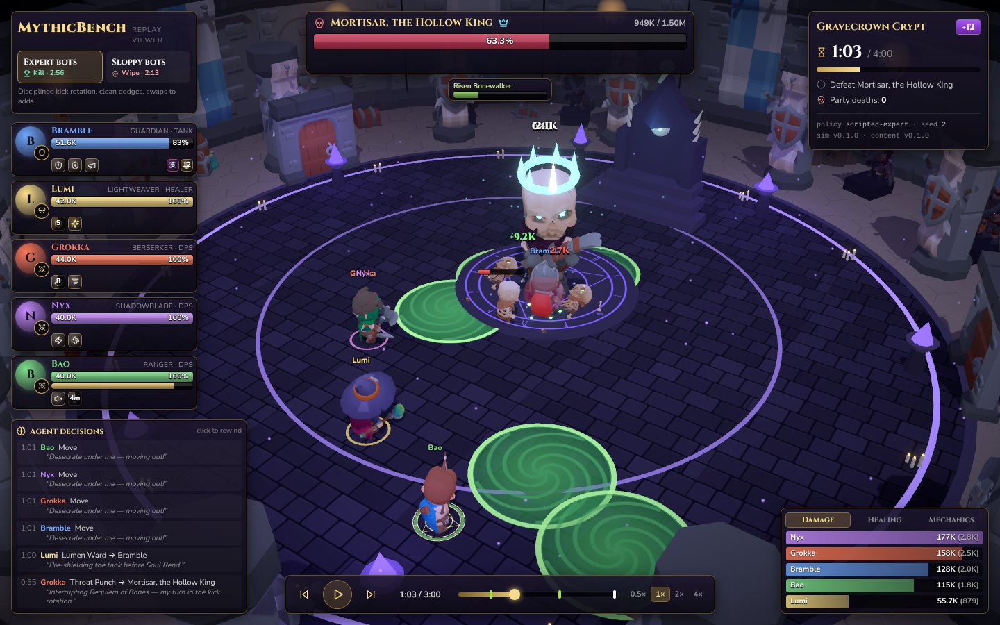

# MythicBench

MythicBench is an open-source benchmark that asks one question: can an AI
model lead a five-person party through a Mythic+-style dungeon it has never
seen, and does it get better with each attempt?

Five agents, one per character and all the same model, play the party: a
tank, a healer and three damage dealers, with a party chat between them. They
start blind: no guide to the boss or the trash, only what the affixes say.
After each wipe they read the same combat log, talk it over, each
rewrite their own notes, and try again, up to five times. Nothing tells them
what to learn. Every fight is a
deterministic simulation that saves a full event log, so you can watch any
attempt in a 3D replay viewer and recompute every score yourself.



The simulator, the dungeon, the model harness and the viewer are working. The
official run across five models is next, followed by a public site with the
leaderboard and a write-up.

## Watch a replay

You need Node 18 or newer and Python 3.10 or newer.

```bash
cd web
npm install
npm run dev
```

Open http://localhost:5173. Space plays and pauses, the arrow keys seek 5
seconds, and 1 to 4 set the speed. Click any line under Agent decisions to
jump to that moment.

Links can point at a moment:
`http://localhost:5173/watch?replay=commander-plus10&t=30&paused=1`.

## The dungeon

The Hollow Vault plays like a Mythic+ key. The party walks in from the
entrance, clears two packs of undead, then kills Oruth the Unburied.
One 4:15 timer covers the whole run.

- The Chapel pack is four Bonewalkers and a Bone Chanter. The Chanter's
  Grave Volley hits the whole party and can be interrupted.
- The Ossuary pack is three Bonewalkers and a Marrow Mender. Its Mend Bones
  heals the pack and can also be interrupted, so the Mender should die first.
- A pack attacks when someone comes within 9 m or hits it. Oruth sleeps
  until someone walks into his room; his ability timers and his 3:15 enrage
  start then.
- Out of combat, the party regains health, and fallen characters get back up
  3 seconds after the fight ends. Each revive adds 10 seconds to the timer.

### Difficulty

There are two tiers, chosen with `--tier normal` or `--tier +10` (the
default).

On Normal, enemies have their full listed health and 90% of their damage,
and there are no affixes. A good group clears it; a careless one doesn't.

On +10, enemies have 85% health and 115% damage, and three affixes change how
the dungeon has to be played:

| Affix | Effect |
| --- | --- |
| Restless Graves | Each undead that dies (Oruth excepted) leaves a grave for 12 seconds. It heals undead standing in it and hurts players standing in it. |
| Marrowburst | Each undead death gives every player a stack of Marrow Shards, which deals damage every second for 4 seconds per stack. Killing a whole pack at once hurts. |
| Hollow Tyrant | Oruth summons adds three times instead of twice, Desecrates four players instead of three, and every 24 seconds or so brands a player with a Grave Mark. Six seconds later it detonates, hitting the marked player and, much harder, everyone within 6 m of them. |

The affixes are always shown to the model, as they are in the game. Only the
boss's abilities are hidden.

### Scoring

Each attempt gets a score from 0 to 100. A wipe earns up to 70, in proportion
to how far the party got: each trash pack is worth 15% and Oruth 70%, by
health removed. A clear earns 70 plus up to 30 for speed, with the full 30
for finishing with a quarter of the timer left. Revive penalties count
against the timer.

A learning episode's progression score is the average of its attempt scores,
with a clear carrying forward to the remaining attempts. A model that learns
faster scores higher. The headline MythicBench score is a model's mean
progression score on +10 (Normal is an unranked sanity check). The order of
the leaderboard is descriptive; one model is called better than another only
where their same-seed paired difference holds up (see the pre-registration).

### The baseline: a scripted commander

The scripted commander plays through exactly the agents' interface (it reads
the same state text and replies with the same orders) using fixed, obvious
rules: kick every cast, kill casters first, heal the lowest ally, step out of
every pool. It never learns. It's one fixed policy: a reference point for what obvious rules do, not a ceiling or a floor. Over 60 seeds it scores 32.7 on +10 (no clears) and 54.5 on Normal.

That gap is by design. Oruth's Bone Pyre is a circle on the floor that two
players must stand in, or it hits the whole party. Every generic instinct
says to step out of glowing circles, so a party has to learn this one from
its combat log. +10 is tuned against real models: the best of today's should
clear it only some of the time.

A clear is timed: Oruth and both packs dead before the 4:15 timer, revive
penalties included. The run ends at the timer, so nothing after it counts.

The viewer ships the commander's run on both tiers (seed 7) as a reference.

## How a model plays

The model reads the game's observation, rendered as text, plus the
rules: every ability's tooltip, the map and the reply format. The rules
contain no strategy. It replies with standing orders for each character: an
optional move and a priority list of `[ability, target]` pairs.

The model is asked for new orders every 4 seconds of game time, and right
away when something happens: a cast starts, pools appear, adds spawn, a pack
is pulled or cleared, someone stands in an armed pool, or an ally gets low or
dies. The game pauses while it thinks, so a slow model is not penalised.

A move can be a coordinate, `"safe"` (a dodge planner that steps out of
harmful pools while keeping the target in range; it ignores a Bone Pyre) or
`"next"` (the next point on the route). Queued interrupts fire 350 ms after a
cast starts, a fast human's reaction time. The model decides when and what;
it doesn't have to do the geometry.

Every model gets the same budget: one shared effort setting and at most
8,000 output tokens per call, thinking included. Invalid entries in a reply
are dropped and counted. If a provider refuses to answer, the refusal is
recorded and the party keeps its previous orders; no other model answers in
its place. Every reply is recorded, so any run can be replayed exactly
without calling the model again.

### Learning over pulls

In a progression run the party starts blind. It knows its own abilities and
the affixes (as the game shows them: Hollow Tyrant names Oruth's summon
thresholds and Grave Mark's cadence), but nothing else about Oruth or the
trash casters: no tooltips, no timers, no warning about the enrage. After each wipe it gets a factual debrief built from the
event log: who died to what, what hit hardest, every boss cast and whether it
was interrupted, the adds, and the time spent in pools. It then rewrites its
team notes (up to about 350 words), which go into the rules for the next
attempt. Each attempt uses a new seed, so memorising timings doesn't help.

The `--memory off` control drops everything between attempts: no debrief, no
talk and no notes. Compared group by group on the same seeds, it measures
whether carrying information across wipes helps. It can't say which part (the
debrief, the talk or the notes) does the work.

## Running models

Put your API keys in `.env` (copy `.env.example`), then from `sim/`:

```bash
python -m mythicsim progress --model mock:basic --episodes 0 --max-pulls 2    # free, no API
python -m mythicsim progress --model anthropic:claude-haiku-5-5@medium --episodes 0-2 --max-pulls 5 --workers 3
python -m mythicsim progress --model openai:gpt-6-luna@medium --episodes 0-2 --max-pulls 5 --memory off
python -m mythicsim llm --model anthropic:claude-haiku-5-5@medium --seeds 0-4    # single fights, no learning
```

A model is written `provider:model@effort`. The effort is one of `none`,
`low`, `medium`, `high`, `xhigh` or `max`, mapped to Anthropic's effort
setting or OpenAI's `reasoning_effort`. Each effort is its own configuration
with its own recording and results. `--workers N` plays N episodes at once;
they are independent, so this only saves time.

### The official protocol

`protocol/v1.json` defines the leaderboard run: five models (Claude Haiku,
Sonnet and Opus 5.5; GPT-6 Luna and GPT-6.2 Sol) at one shared effort, six
blind groups each on +10 (a group is a fresh party with up to five pulls),
paired memory-off controls on the two cheapest models, Normal as a sanity
check, and low/high effort sweeps for cost curves. The questions, metrics,
analysis and stopping rules were fixed before the run, in
[docs/PREREGISTRATION.md](docs/PREREGISTRATION.md).

```bash
python -m mythicsim campaign ../protocol/v1.json --dry-run     # what's left and the worst-case cost
python -m mythicsim campaign ../protocol/v1.json --first 1     # stage 1: each cell's first group
python -m mythicsim campaign ../protocol/v1.json --workers 3   # the rest; safe to stop and rerun
python -m mythicsim results ../protocol/v1.json --out ../results/v1
```

To run a stage in a Claude Code cloud session (laptop closed, followed from the
Claude app), see [docs/CLOUD_RUN.md](docs/CLOUD_RUN.md) and
`scripts/cloud_stage.sh`.

If stage 1 turns up a harness fault, the pre-registered restart is its own
pinned protocol on the reserve seeds: run `protocol/v1-restart.json` the same
way (`--first 1`, then the rest), after the fix and a version bump.

`campaign` only plays episodes that haven't finished. Recorded replies make a
replayed episode free up to the point where it stopped. `results` writes
`leaderboard.json` with, for each model and tier, the progression score and
its confidence interval, the clear rate with an exact interval, attempts to
clear, the learning effect (paired, memory on minus off), the same-seed
comparison of every pair of models, and the cost per attempt. It also writes
a gzipped replay of every attempt, the recorded replies, and
`served_models.json` (the model ids the providers report serving).

### Cost limits

Every run records its cost at list prices; the table is in
`sim/mythicsim/spend.py`. A run stops when its API spend reaches
`--budget-usd` (default $20) and keeps the fights it finished. Every real
API call is logged to `runs/spend.jsonl`, and no run may spend past
`MYTHICBENCH_TOTAL_BUDGET_USD` (in `.env`, default $500). Recorded replies
cost nothing.

```bash
python -m mythicsim runs spend    # spending so far, by model and by run
```

### Managing runs

Each command creates a run folder under `runs/` with a `manifest.json` (model,
settings, harness version, prompt hash, git commit, summary) and one replay
per fight. Name and tag runs with `--name` and `--tag`.

```bash
python -m mythicsim runs list --model haiku
python -m mythicsim runs show a1b2        # any unique part of the run id
python -m mythicsim runs rm a1b2
python -m mythicsim runs publish --all    # refresh the viewer's run list
```

In the viewer, the button in the top bar opens the run list, with search,
filters and a score for each attempt. Runs from an older harness version are
hidden by default because their scores aren't comparable.

### Analysing results

`export` turns runs or a results folder into flat files for spreadsheets,
pandas or an LLM:
- `overview.md`, every cell plus averages by pull number;
- CSVs of pulls, groups, deaths, mechanics (each kick, Bone Pyre and Grave
  Mark) and damage taken;
- every model call as JSONL;
- one readable story per group, with the timeline, debrief, talk and notes
  for each pull.

It only reads, so it never changes a run or a score.

```bash
python -m mythicsim export ../web/public/results/v1 --zip   # a results dataset
python -m mythicsim export --tag soak-check                 # local runs (or --run <id>)
```

It writes to `runs/analysis/<name>/`. Add `--prompts` to include every call's
full prompt, which makes the export much bigger.

The website does the same in the browser and downloads a zip. In the run list,
**Export this run** exports one run, and **Export N runs** exports every run
the search and filters show. The files are byte-identical to the command's,
and both test suites check this against one shared fingerprint
(`sim/tests/export_sample_digest.json`). The website exports what its run
list shows: the leaderboard's groups and the memory-off controls. For the
effort sweeps and the extra memory-on groups behind the learning effect,
export the full results folder with the command.

## Simulator commands

```bash
cd sim
pip install -e ".[dev]"                                              # only needed for the tests
python -m mythicsim run --seed 7 --tier +10                          # the scripted commander, one run
python -m mythicsim generate --out ../web/public/replays             # rebuild the viewer's reference replays
python -m pytest
```

## The website

`web/` is also the public site. `/` has the leaderboard and charts, `/watch`
is the replay viewer (`/watch/<model>/<tier>/<episode>/<pull>` opens one
pull), `/paper` is the write-up (`web/src/pages/paper.mdx`), and `/about`
explains the project. The site reads only the dataset that `results` writes,
from `web/public/results/<name>/`. `RESULTS_DIR` in `web/src/site/config.ts`
(or the `VITE_RESULTS_DIR` variable) picks which one. It ships with
`results/sample`, made with the mock model, which costs nothing:

```bash
cd web && npm run sample    # protocol/sample.json: campaign, then results
```

`npm run build` writes a static site to `web/dist`, with a copy of
`index.html` for each page so link previews show the right title. For
hosting, `web/vercel.json` (Vercel) and `web/public/_redirects` (Cloudflare
Pages) send every other path to the app.

## Why the numbers hold up

- The simulator is deterministic. The same seed and the same decisions give a
  byte-identical replay on any machine, because it avoids math functions whose
  last digit can differ between CPUs. CI checks this on Linux against replays
  made on a Mac.
- The event log is the only output. The viewer and every metric are computed
  from the replay file alone, and the tests check each event's health values
  against a running total.
- The viewer is tested against the simulator: it must reproduce the final
  state and every score, and jumping to any moment must match playing from
  the start.
- The scripted commander and the models use the same interface. Neither can
  see engine internals.
- Every replay records the simulator, content and harness versions, the seed
  and the policy, so results from different rules are never mixed silently.

More detail is in [docs/ARCHITECTURE.md](docs/ARCHITECTURE.md).

## For WoW players

The names, art and numbers are all original, but the design will feel
familiar:

| MythicBench | In WoW terms |
| --- | --- |
| Oruth the Unburied | the last boss of the key |
| Requiem of Bones (interruptible party damage) | the cast you have to kick |
| Soul Rend (tank buster) | press your big defensive |
| Desecrate (pools under three players) | don't stand in the bad |
| Summon the Restless | add waves to swap to |
| Hollow Fury, 3:15 after the pull | the hard enrage |
| Grave Mark (+10) | the spread debuff: run out of the group |
| Restless Graves, Marrowburst, Hollow Tyrant | the week's affixes |

| Class (role) | Key abilities | Closest WoW match |
| --- | --- | --- |
| Guardian (tank) | Ironhide, Rampart Bash, Challenging Roar | Shield Wall, Pummel, Challenging Shout |
| Lightweaver (healer) | Mending Light, Bloomward, Lumen Ward, Radiant Hymn | Flash Heal, Renew, Power Word: Shield, Divine Hymn |
| Berserker (damage) | Ravage, Cleaving Storm, Throat Punch | Fury Warrior with Whirlwind and Pummel |
| Shadowblade (damage) | Twin Fang, Venom Burst, Scatterblades, Quick Jab | Rogue with Fan of Knives and Kick |
| Ranger (damage) | Steady Arrow, Piercing Shot, Silencing Arrow, Wild Roar | Hunter with Counter Shot and Bloodlust |

## Repository layout

```
schema/replay.schema.json   the replay format (JSON event log)
protocol/v1.json            the official run: models, tiers, episodes
sim/                        Python simulator, standard library only
  mythicsim/content.py      game rules as data: classes, abilities, boss, dungeon, tiers
  mythicsim/engine.py       100 ms tick loop that writes the event log
  mythicsim/dungeon.py      the dungeon run: map, packs, pulling, resting
  mythicsim/dodge.py        the "safe" move's dodge planner
  mythicsim/metrics.py      scores, computed only from the event log
  mythicsim/llm/            model harness: prompt, clients, debrief, learning episodes
  mythicsim/campaign.py     the official protocol and the results dataset
  mythicsim/spend.py        prices and cost limits
  tests/
web/                        React and three.js replay viewer
  src/replay/               replay engine (no 3D, unit-tested)
  src/scene/                the 3D dungeon, characters and effects
  src/hud/                  the game interface
docs/                       architecture notes, asset guide, design audit
```

## Credits and license

The code is MIT-licensed. The characters, animations and dungeon pieces are
KayKit packs by Kay Lousberg, released under CC0. The idea of a careful,
readable game-based eval owes a lot to Dwarkesh Patel's
[Clocktower Bench](https://clocktowerbench.com/). Full credits are in
[THIRD_PARTY.md](THIRD_PARTY.md).

MythicBench is an independent project. It is not affiliated with or endorsed
by Blizzard Entertainment. World of Warcraft and Mythic+ are trademarks of
Blizzard Entertainment, Inc.
